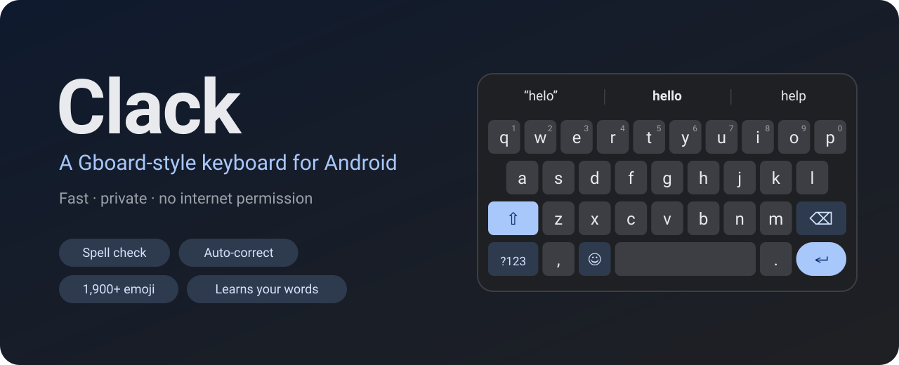

<p align="center">
  
</p>

<p align="center">
  <a href="https://github.com/wellsey001/Clack/releases/latest"></a>
  <a href="https://github.com/wellsey001/Clack/actions/workflows/build.yml"></a>
  
  
  
  
</p>

<p align="center">
  <b>The keyboard you know, minus the cloud.</b><br>
  Clack looks and feels like Gboard: suggestions, auto-correct, every emoji, swipe gestures.<br>
  It doesn't ask for internet access, so <i>nothing you type can leave your phone</i>.
</p>

---

## ✨ Highlights

| | |
|---|---|
| ⌨️ **Feels like Gboard** | Material You colours, flat keys, a pill-shaped enter key and light/dark themes that follow your system. |
| 〰️ **Glide typing** | Swipe across the letters to type a word, with a trail that follows your finger. Words glide together with spaces added, two runner-up words wait in the bar, and delete removes the whole glided word. |
| 🫧 **Glass theme** | A frosted, translucent keyboard that blurs the app behind it (Android 12+), matching the Perch launcher. |
| ✋ **Make it yours** | Key borders, letter size, key spacing and a one-handed mode (left or right). |
| 🔤 **Spell check** | Misspelt words get a fix in the middle of the suggestion bar: *teh → the*, *recieve → receive*, *dont → don't*. |
| 🧩 **Fixes run-together sentences** | Missed spaces, a letter hit instead of the space bar, and a typo or two: *seeyoutomorrow* → **see you tomorrow**, *thankbyou* → **thank you**, *helloohowareyou* → **hello how are you**. |
| ✅ **Auto-correct** | Corrects when you press space, but only when one fix is clearly right. Press delete to undo it. |
| 🔮 **Next-word prediction** | After a space, Clack suggests what usually comes next: *see you* → **soon**, *on my* → **way**. It learns your own phrases too. |
| 🔠 **Smart capitals** | *i* → **I**, *monday* → **Monday**, and names you write with a capital, like *sarah* → **Sarah**. Press delete to undo. |
| 🧠 **Learns your words** | Use a new word a few times (3 by default, you choose) and Clack treats it as correct and suggests it, so one-off typos never stick. Names, slang and in-jokes included. |
| 😀 **1,900+ emoji** | Every emoji your phone can show, in categories, with recently used emoji and skin tones. **Search** by name (*pizza*, *love*, *cat*). |
| ¯\\\_(ツ)\_/¯ **Emoticons and kaomoji** | Tabs of classic `:)` `<3` `^_^` faces and kaomoji, one tap away. |
| 📋 **Clipboard history** | Your recent copies from the last hour, a tap away; pin the ones you paste often. Passwords copied from password managers are never stored. |
| ⚡ **Text shortcuts** | Type `@@` and your email address is offered in the bar. Set your own in settings. |
| 🔢 **Number pad** | Big keypad for amounts, PINs and codes, with `* # +` for phone numbers. |
| 📖 **My words** | See, search, add and delete the words Clack has learned. |
| 🔑 **Sign-in codes** | A "Paste code" button appears when a verification code arrives in a notification or is copied. It's held in memory for 5 minutes and never saved. |
| 🔒 **Private by design** | No internet permission, no analytics, no accounts. Nothing is learned from passwords, emails, web addresses or incognito tabs. |
| 🪶 **Tiny** | About 1 MB, pure Kotlin, zero third-party libraries. |

## 👆 Gestures and shortcuts

| Do this | To get this |
|---|---|
| **Hold** a letter, then slide | Accents and symbols (é, ñ, ß…) |
| **Slide** along the space bar | Move the cursor |
| **Slide left** from delete | Select and delete whole words |
| **Hold** delete | Keep deleting |
| **Hold** the space bar | Switch to another keyboard |
| **Double-tap** shift | Caps lock |
| **Double-tap** space | Full stop and a space |
| **Delete** right after an auto-correct | Undo it, and never correct that word again |
| **Hold** a suggestion | Forget a word Clack learned |
| **Hold** an emoji | Pick a skin tone |
| Tap 🔍 in the emoji panel | Search emoji by name |
| Tap a suggestion after a space | Accept the predicted next word |
| Tap **Paste code** in the top bar | Paste a sign-in code that just arrived (✕ to dismiss) |
| Type `.` `,` `!` `?` after picking a suggestion | The extra space goes after the punctuation, as in Gboard |

## 📲 Install

1. On your phone, download **[Clack.apk](https://github.com/wellsey001/Clack/releases/latest/download/Clack.apk)**. This link always points to the newest version.
2. Open the file to install it. Allow your browser to install apps if Android asks.
3. Open **Clack** and follow the two steps: **Enable** it, then **Switch** to it.

**Updating:** in Clack's settings, tap **Download the latest version**. Every change gets its own [release](https://github.com/wellsey001/Clack/releases) with notes on what's new.

> Android shows a standard warning that a keyboard "may be able to collect all the text you type".
> Every keyboard gets this warning. Clack can't send anything anywhere, because it has no internet permission.

Every build is signed with the same key, so updates install over the top. You don't need to uninstall first.

## ⚙️ Settings

Open the Clack app or tap ⚙ in the toolbar:

- Number row · word suggestions · auto-correct · automatic capitals · double-space full stop
- Key-press pop-up · number hints on the top row
- Vibration · key sounds
- Theme: follow system / light / dark
- Keyboard height: short / normal / tall

## 🔑 Sign-in codes

Clack can spot codes such as *"482913 is your verification code"* in two ways:

- **Notifications.** Turn on *notification access* in Clack's settings. Because Clack is installed outside the Play Store, Android may first ask you to open Clack's app info, tap ⋮, then choose **Allow restricted settings**.
- **Copied text.** Copy a code (many messaging apps add a *Copy code* button to the notification) and Clack offers it right away. This works on every Android version.

> **Android 15+:** Android now hides codes in most notifications from apps that aren't built into the phone, so copying the code is the reliable route there.

Only the code is kept, in memory, for 5 minutes or until you paste or dismiss it. No other notification content is read or stored.

## 🔍 How the spell checker works

Clack uses no AI model and has no server. It combines a few simple ideas:

1. **A ranked word list.** 50,000 English words ordered by how often people use them, so *the* beats *thee*.
2. **Typo patterns.** For an unknown word it tries every one-letter mistake: swapped letters, a missing or extra letter, a missed apostrophe, or the wrong key. A wrong key **next to** the right one on the keyboard counts as more likely.
3. **Your vocabulary.** Words you type are counted on the phone, and words you use often rank higher.
4. **Run-together text.** If a long "word" isn't a word, Clack tries every way to cut it into real words, allowing for a slipped space-bar key (b, n, v, c, m) and small typos, and picks the likeliest using how common each word is. Only clear-cut splits are applied automatically; others are offered in the bar.
5. **Caution.** Auto-correct only acts when the best fix clearly beats the runner-up, and never in passwords, emails or web addresses.

## 🏗️ Project layout

```
app/src/main/
├── java/com/wellsey/clack/
│   ├── ClackIME.kt             # the input method service: connects keys to apps
│   ├── KeyboardView.kt         # draws the keys and handles touches and gestures
│   ├── SuggestionStripView.kt  # toolbar / suggestion bar
│   ├── EmojiPanelView.kt       # scrolling emoji grid, categories, skin tones
│   ├── Dictionary.kt           # completions, spell check, auto-correct, learning
│   ├── Layouts.kt              # key layouts and colour themes
│   ├── Icons.kt                # hand-drawn line icons
│   ├── Prefs.kt                # settings
│   └── SetupActivity.kt        # launcher screen: setup and settings
└── assets/
    ├── words.txt               # 50k English words, most common first
    └── emoji.txt               # emoji by category
```

## 🛠️ Build it yourself

Every push to `main` builds an APK with GitHub Actions. To build locally you need JDK 17 and the Android SDK:

```bash
gradle assembleDebug
# → app/build/outputs/apk/debug/app-debug.apk
```

## 🗺️ Ideas for later

- [ ] Voice typing
- [ ] More languages

## 🙏 Credits

- Word frequencies: [FrequencyWords](https://github.com/hermitdave/FrequencyWords) by Hermit Dave (code MIT; word data CC BY-SA 4.0), filtered to the 50,000 most common English words.
- Emoji list: [unicode-emoji-json](https://github.com/muan/unicode-emoji-json) by Mu-An Chiou (MIT).
- Common misspellings were filtered out of the word list at build time using [codespell](https://github.com/codespell-project/codespell)'s list (not included in the app).
- Emoji search keywords: [emojilib](https://github.com/muan/emojilib) by Mu-An Chiou (MIT).
- Inspired by Gboard. Clack isn't affiliated with or endorsed by Google.
